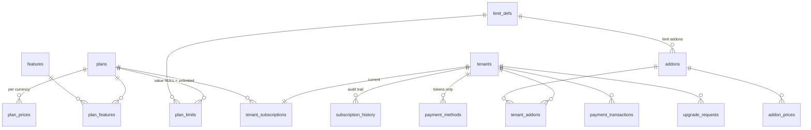

# Subscription & Plan Management — design and status

Implemented 2026-10-14 on top of the multi-tenant work (see `PLAN-multitenant.md`). **Not committed or pushed.**
Rollback: `backups/pre-subscriptions/` (20 files + `MANIFEST.txt`), git tag `pre-subscriptions-2026-10-14`.

## Rules (as built)
- **Super admin only** manages the catalog (plans, prices, features, limits, addons) and every tenant's subscription.
- A **tenant admin** can read their plan/usage ("My Plan"), attach a card, and **upgrade only with a payment method on file**.
  Without one the API answers `403 CONTACT_ADMIN` and the UI tells them to contact the administrator (optional "Request this plan" → queue for the super admin).
  Downgrade, cancel, renew, addons and custom plans are super-admin actions.
- Default plans (placeholder prices, editable): **Basic** (1 branch, 10 users), **Silver** (3 / 25), **Gold** (10 / 100, reports, API), **Platinum** (unlimited, priority support), **Custom** (hidden from tenants; clone it per tenant).
- Currencies: **USD → Stripe**, **PKR → JazzCash or OPay** (`PKR_PROVIDER`, default `jazzcash`).

## Data model (all rows, so new plans/features/limits/addons need no code or schema change)

`tenant_subscriptions.status`: trial · active · grace · expired · suspended · cancelled. `end_date NULL` = never expires (existing company).
`subscription_history.action`: activate, upgrade, downgrade, plan_change, renewal, cancellation, suspension, reactivation, status_change (system), addon_add/remove, payment_method_added/removed, upgrade_requested, payment_rejected, migrated.
Indexes: `tenant_subscriptions(status, end_date)`, `subscription_history(tenant_id, created_at desc)`, `payment_transactions(tenant_id, created_at desc)`, unique `payment_transactions(provider, provider_ref)`, `tenant_addons(tenant_id, status)`, `payment_methods(tenant_id, status)`.
All of these are platform tables: no RLS, **revoked from the tenant DB role** (`crm_app`); only services with an explicit `tenant_id` touch them.
`tenants.plan` still mirrors the plan code (compat). Existing tenants migrate: basic→Basic, pro→Silver, platinum→Platinum, active, no expiry.

## Enforcement (service layer, not only routes)
- `entitlementService.getEntitlements(tenantId)` = plan + active addons → features, limits, `canWrite`; advances the status by date on request (no scheduler): active/trial → **grace** (`grace_days`, default 7, full access + warning banner) → **expired**.
- `assertFeature` / `assertLimit` / `assertLimitFor` → `403` with `FEATURE_NOT_IN_PLAN`, `BRANCH_LIMIT_REACHED`, `USER_LIMIT_REACHED`, `TRANSACTION_LIMIT_REACHED`, … and an upgrade hint ("Upgrade from My Plan" if a payment method exists, else "Contact your administrator").
- Wired in: branch create/activate/assign (`tenantService`), user create (`dealers`, `auth/register`), transactions per month (`ledgerService`). `storage_gb` and `api_requests` are defined and shown but **not metered yet**.
- Expired / cancelled / suspended = **read-only**: the auth layer returns `403 SUBSCRIPTION_INACTIVE` for writes, and Postgres RLS blocks them too (`app_can_write()` in every write policy).
- Downgrade never deletes data: creation is blocked and branches beyond the limit are frozen read-only (default branch first, then oldest).

## API
Super admin: `/api/plans` (+ `/:id`, `/prices`, `/features`, `/limits`, `/clone`), `/api/features` (+ `/limits`), `/api/addons`,
`/api/subscriptions` (list, `/expiring`, `/report`, `/upgrade-requests`, `/:tenantId` detail, `POST /:tenantId/{activate,change-plan,renew,cancel,suspend,reactivate,addons,payment-method/enable}`).
Tenant admin: `GET /api/subscription`, `POST /api/subscription/{upgrade,upgrade-request,payment-method/setup}`, `DELETE /api/subscription/payment-method`.
Providers → us (signature-verified, no user token): `POST /api/billing/webhook/stripe`, `POST /api/billing/callback/opay`, `POST /api/billing/return/hosted` (JazzCash).

## Payments
- One adapter interface (`server/services/payments/`): `stripe`, `jazzcash`, `opay`, plus `fake` (dev only, `PAYMENTS_FAKE=1`). A plan changes **only** in `subscriptionService.finalizePayment`: idempotent, amount/currency-checked; a mismatch is committed as failed and stays failed.
- No card numbers/CVV/PINs ever reach this server or DB: Stripe Checkout (setup mode) is hosted by Stripe; we store provider ids, brand, last4.
- **Stripe** (USD): tenant attaches a card via Checkout; upgrade = off-session charge of the saved card; webhooks verify `Stripe-Signature` (HMAC-SHA256, 5 min tolerance).
- **JazzCash / OPay** (PKR): hosted checkout only, no saved card. "Payment method attached" = the **super admin enables** the provider for the tenant (`Enable JazzCash/OPay checkout`); the tenant is then redirected to the provider's page and the plan changes only after the verified callback. OPay callbacks are also confirmed with OPay's status API before trusting them.
- **Verification status:** adapters follow each provider's docs and are covered by fixture tests (tamper/replay/amount), but **none has been run against a live or sandbox account**. JazzCash has no current official spec found (2019 guide + community code): its hash rule and endpoint **must be checked in your merchant portal**. OPay's docs only list Egypt (EG/EGP): **confirm PKR support** with OPay. Stripe may not onboard a Pakistan-registered business: confirm eligibility.

Environment variables (server): `STRIPE_SECRET_KEY`, `STRIPE_WEBHOOK_SECRET`; `JAZZCASH_MERCHANT_ID`, `JAZZCASH_PASSWORD`, `JAZZCASH_INTEGRITY_SALT`, `JAZZCASH_CHECKOUT_URL`;
`OPAY_MERCHANT_ID`, `OPAY_PUBLIC_KEY`, `OPAY_PRIVATE_KEY`, optional `OPAY_BASE_URL`, `OPAY_COUNTRY`; `PKR_PROVIDER` (`jazzcash`|`opay`); `APP_URL` (client URL for return links), `API_PUBLIC_URL` (public server URL for provider callbacks). Never commit these.

## Files
New: `server/config/subscriptionSchema.js`, `server/services/{entitlementService,subscriptionService,catalogService}.js`, `server/services/payments/*`, `server/routes/{catalog,subscriptions,subscription,billing,handle}.js`, `server/tests/{payments,subscriptions.db}.test.js`, `client/src/pages/{Plans,Subscriptions,MyPlan}.js`.
Changed: `server/config/{multiTenant,dbInit,database}.js`, `server/index.js`, `server/middleware/auth.js`, `server/services/{tenantService,ledgerService}.js`, `server/routes/{auth,dealers,branches}.js` (+ the generic error handler in the other routes now keeps a service's status/message), tests, `package.json`, client `App.js`, `Layout.js/.css`, `AuthContext.js`, `Tenants.js`, `PlatformDashboard.js`.

## Verified
Throwaway Postgres 18 (port 5544): legacy dump migrates identically twice (row counts and ledger unchanged, company → Platinum, active, no expiry); `npm test` 36/36 (11 pure + 25 database: limits, addons, gating, expiry/grace/read-only, cancel/suspend/reactivate, up/downgrade with excess usage, card and hosted upgrade flows, replay/forged-amount/foreign-provider callbacks, global tables invisible to tenants); real server + client exercised end to end as super admin and as a tenant admin (edit plan, request upgrade, add test card, upgrade, hit the branch limit, simulate expiry → banner + read-only, renew).
**Not verified:** any real provider account; mobile layout of the three new pages; storage/API metering.
